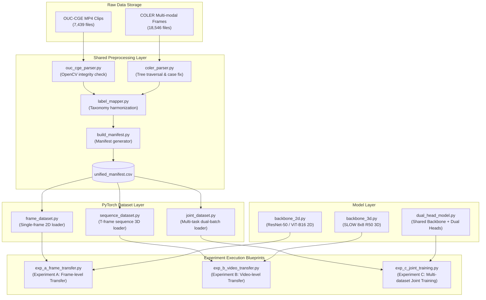
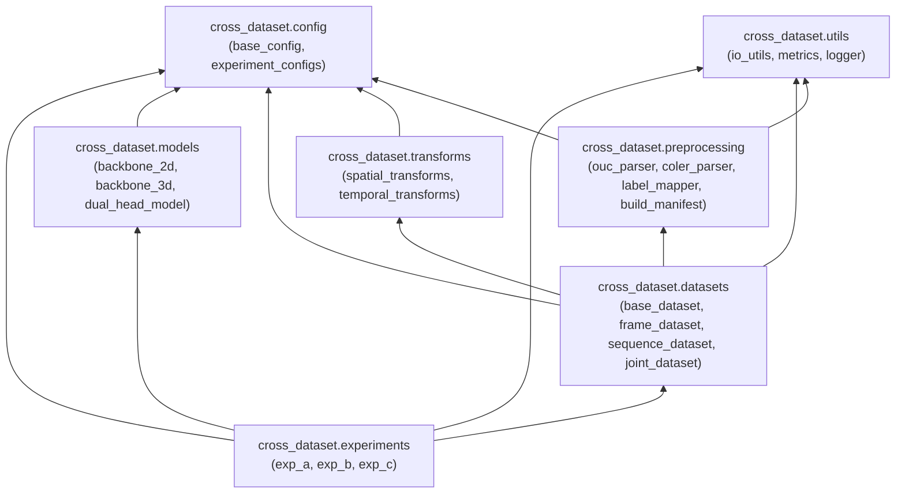

# Architecture Design: Cross-Dataset Pipeline for Video Engagement Recognition

**Version**: 1.0.0  
**Status**: Proposal & Technical Architecture Design  
**Scope**: Modular data ingestion, preprocessing, dataset abstractions, model wrappers, and experiment design for OUC-CGE and COLER datasets.

---

## 1. Architectural Philosophy & Principles

To enable seamless execution across **Experiment A** (Frame-Level Transfer), **Experiment B** (Video/Sequence-Level Transfer), and **Experiment C** (Joint Multi-Dataset Training), the pipeline architecture strictly adheres to three core software engineering principles:

1. **Single Source of Truth Preprocessing**: Raw datasets (OUC-CGE video files and COLER frame trees) are parsed *once* to construct a normalized, flat dataset manifest (`unified_manifest.csv`). All experiments consume this manifest, ensuring zero redundant data cleaning or re-parsing.
2. **Decoupled Data Modality Loaders**: Data loading, image/sequence transforms, label mapping, and model execution are cleanly isolated. PyTorch `Dataset` implementations handle modality representation (2D single frame vs 3D sequence vs multi-head joint batching), while model backbones remain modality-agnostic.
3. **Strict Layering & Zero Circular Dependencies**: High-level experiment orchestrators depend on lower-level datasets and models, which in turn depend strictly on foundational utilities and data contracts.

---

## 2. Directory Structure Design

The proposed modular pipeline lives under a clean package namespace `cross_dataset/`:

```
cross_dataset/
├── __init__.py
├── config/
│   ├── __init__.py
│   ├── base_config.py             # Base dataclasses & global paths
│   └── experiment_configs.py     # Config schemas for Exp A, B, and C
│
├── preprocessing/                 # ★ SHARED PREPROCESSING MODULES
│   ├── __init__.py
│   ├── ouc_cge_parser.py          # Scans & validates OUC-CGE MP4 clips
│   ├── coler_parser.py            # Traverses nested COLER Goc/Table file tree
│   ├── label_mapper.py            # Converts raw labels -> 3-class / 2-class taxonomy
│   └── build_manifest.py          # CLI tool: generates unified_manifest.csv
│
├── datasets/                      # ★ PYTORCH DATASET IMPLEMENTATIONS
│   ├── __init__.py
│   ├── base_dataset.py            # Abstract Base Dataset reading manifest CSV
│   ├── frame_dataset.py           # Single-frame loader for 2D models (Exp A)
│   ├── sequence_dataset.py        # Multi-frame / video sequence loader for 3D (Exp B)
│   └── joint_dataset.py           # Multi-task batch sampler for dual heads (Exp C)
│
├── transforms/                    # ★ SPATIAL & TEMPORAL TRANSFORMS
│   ├── __init__.py
│   ├── spatial_transforms.py      # Resizing, spatial cropping, ImageNet normalization
│   └── temporal_transforms.py     # Frame sampling (uniform stride, border padding)
│
├── models/                        # ★ NEURAL NETWORK ARCHITECTURES
│   ├── __init__.py
│   ├── backbone_2d.py             # ResNet-50 / ViT-B16 2D feature extractors
│   ├── backbone_3d.py             # SlowFast / X3D 3D temporal models
│   └── dual_head_model.py         # Shared backbone + dataset-specific heads (Exp C)
│
├── utils/                         # ★ FOUNDATIONAL UTILITIES
│   ├── __init__.py
│   ├── io_utils.py                # Safe OpenCV video reader & PIL loader
│   ├── metrics.py                 # Standalone Accuracy, Macro-F1, QWK calculators
│   └── logger.py                  # Structured logging & stdout formatting
│
└── experiments/                   # ★ EXPERIMENT EXECUTORS (No training implementation)
    ├── __init__.py
    ├── exp_a_frame_transfer.py    # Runner blueprint for Exp A (Frame Transfer)
    ├── exp_b_video_transfer.py    # Runner blueprint for Exp B (Video Transfer)
    └── exp_c_joint_training.py    # Runner blueprint for Exp C (Joint Training)
```

---

## 3. Module Responsibilities Breakdown

### 3.1 Configuration Module (`cross_dataset/config/`)
- `base_config.py`: Defines immutable dataclasses for dataset paths (`DATASET_ROOT_OUC`, `DATASET_ROOT_COLER`), artifact export directories, and hardware flags.
- `experiment_configs.py`: Holds hyperparameter schemas (batch size, learning rates, target resolution, input sequence length $T$) for Experiments A, B, and C.

### 3.2 Shared Preprocessing Module (`cross_dataset/preprocessing/`)
- `ouc_cge_parser.py`: Recursively scans OUC-CGE directories, runs OpenCV integrity checks (filtering 142 corrupted files), extracts frame counts and video resolution.
- `coler_parser.py`: Traverses COLER's 5-level nested hierarchy (`Goc` $\rightarrow$ `Table` $\rightarrow$ Class $\rightarrow$ `X` $\rightarrow$ `Video` $\rightarrow$ `id`), handles capitalization quirks (e.g. `Very Engagement` vs `Very engagement`), handles missing directories, and catalogues RGB frame paths, emotion crop paths, and skeleton CSV paths.
- `label_mapper.py`: Enforces standard label mappings:
  - **3-Class Standard**: Low (`0`), Mid (`1`), High (`2` $\leftarrow$ Engaged + Very Engaged).
  - **2-Class Binary**: Not Engaged (`0` $\leftarrow$ Low + Mid / Disengaged + Normal), Engaged (`1` $\leftarrow$ High / Engaged + Very Engaged).
- `build_manifest.py`: Master CLI tool that executes parsers and generates the standardized `unified_manifest.csv`.

### 3.3 Dataset Loaders (`cross_dataset/datasets/`)
- `base_dataset.py`: Abstract PyTorch `Dataset` that loads `unified_manifest.csv` and filters records by dataset name, split fold, or modality requirements.
- `frame_dataset.py`: Samples single keyframes (midpoint frame for OUC-CGE video clips, midpoint PNG frame for COLER). Used by **Experiment A**.
- `sequence_dataset.py`: Uniformly samples $T$ temporal frames (e.g. $T=8$ or $T=16$). Decodes OUC-CGE videos on the fly or loads COLER frame sequences with nearest-neighbor padding if sample frame count $<T$. Used by **Experiment B**.
- `joint_dataset.py`: Implements a multi-task dataset wrapper that draws balanced mini-batches alternating between OUC-CGE and COLER samples. Used by **Experiment C**.

### 3.4 Spatial & Temporal Transforms (`cross_dataset/transforms/`)
- `spatial_transforms.py`: Reusable PyTorch/Torchvision image pipelines for training (random scale crop 224x224, random horizontal flip, ImageNet mean/std normalization) and validation/testing (center crop 256x256 $\rightarrow$ 224x224).
- `temporal_transforms.py`: Frame indexing logic: uniform stride sampling, random temporal jittering, and border frame duplication for short clips.

### 3.5 Model Layer (`cross_dataset/models/`)
- `backbone_2d.py`: Wraps 2D ImageNet-pretrained ResNet-50 / ViT-B/16 models with configurable classification heads.
- `backbone_3d.py`: Wraps 3D SlowFast (SLOW 8x8 R50) or X3D architectures for video sequence inputs.
- `dual_head_model.py`: Architecture featuring a shared 2D/3D feature extractor backbone connected to two distinct output classification heads:
  - **Head 1**: OUC-CGE classifier (3 classes).
  - **Head 2**: COLER classifier (4 classes or 3 classes).

### 3.6 Foundational Utilities (`cross_dataset/utils/`)
- `io_utils.py`: Robust image and video readers with fallback handling for unreadable frames.
- `metrics.py`: Standardized computation of Top-1 Accuracy, Macro-F1 Score, and Quadratic Weighted Kappa (QWK).
- `logger.py`: Standard logger output formatter.

---

## 4. Shared Preprocessing Strategy

All three experiments (A, B, and C) share **100% of the preprocessing pipeline**. Preprocessing is completely decoupled from model training and dataset loading.

```
+-----------------------------------------------------------------------------------+
|                            RAW DATASET SOURCES                                    |
|   • OUC-CGE: 7,439 MP4 files under high/, mid/, low/                              |
|   • COLER: 18,546 multi-modal files under Ver4/Goc{1..5}/Table{1..3}/             |
+-----------------------------------------------------------------------------------+
                                         |
                                         v
+-----------------------------------------------------------------------------------+
|                        PREPROCESSING MODULE RUNNER                                |
|                        (preprocessing/build_manifest.py)                          |
|                                                                                   |
|  1. OUC Parser: Filters corrupted MP4s, verifies duration & FPS                    |
|  2. COLER Parser: Normalizes folder names, handles case discrepancies              |
|  3. Label Mapper: Maps raw labels -> 3-Class Standard & 2-Class Binary            |
|  4. Stratified Splitter: Assigns balanced 5-fold CV fold indices                  |
+-----------------------------------------------------------------------------------+
                                         |
                                         v
+-----------------------------------------------------------------------------------+
|                        UNIFIED MANIFEST CSV ARTIFACT                              |
|                       (data/manifests/unified_manifest.csv)                       |
|                                                                                   |
|  Columns: sample_id, dataset_name, relative_path, file_type, num_frames,          |
|           raw_label, label_3class, label_binary, split_fold                       |
+-----------------------------------------------------------------------------------+
                                         |
         +-------------------------------+-------------------------------+
         |                               |                               |
         v                               v                               v
+------------------+           +------------------+           +------------------+
|   EXPERIMENT A   |           |   EXPERIMENT B   |           |   EXPERIMENT C   |
| Frame Transfer   |           | Video Transfer   |           | Joint Multi-Task |
| (frame_dataset)  |           | (seq_dataset)    |           | (joint_dataset)  |
+------------------+           +------------------+           +------------------+
```

### Manifest Schema Standard (`unified_manifest.csv`)

| Column Name | Type | Description | Example (OUC-CGE) | Example (COLER) |
|---|---|---|---|---|
| `sample_id` | `str` | Unique identifier | `ouc_high_2037` | `coler_g1_t1_v1196_id3` |
| `dataset_name` | `str` | Dataset tag | `OUC-CGE` | `COLER` |
| `relative_path` | `str` | Relative file/folder path | `high/high-2636(2001-2190)/view2037.mp4` | `Goc1/Table1/Engagement/X2_Goc1/Video1196/id_3` |
| `file_type` | `str` | Modality format | `mp4` | `png_sequence` |
| `num_frames` | `int` | Total available frames | `300` | `15` |
| `raw_label` | `str` | Original dataset label | `High` | `Very engagement` |
| `label_3class` | `int` | Standardized 3-class label | `2` (High) | `2` (High) |
| `label_binary` | `int` | Standardized binary label | `1` (Engaged) | `1` (Engaged) |
| `split_fold` | `int` | Assigned fold (0–4) | `0` | `0` |

---

## 5. End-to-End Data Flow Diagram



---

## 6. Dependency Graph

The modular architecture enforces strict unidirectional dependencies to eliminate circular coupling:



---

## 7. Reusability Matrix Across Experiments A, B, and C

The table below demonstrates how each experiment reuses core pipeline modules:

| Pipeline Component | Experiment A: Frame Transfer | Experiment B: Video Transfer | Experiment C: Joint Training |
|---|---|---|---|
| **Preprocessing Script** | `build_manifest.py` (Reused) | `build_manifest.py` (Reused) | `build_manifest.py` (Reused) |
| **Manifest File** | `unified_manifest.csv` (Reused) | `unified_manifest.csv` (Reused) | `unified_manifest.csv` (Reused) |
| **Label Mapping** | `label_mapper.py` (3-Class) | `label_mapper.py` (3-Class) | `label_mapper.py` (Dual / 3-Class) |
| **Spatial Transforms** | `spatial_transforms.py` | `spatial_transforms.py` | `spatial_transforms.py` |
| **Temporal Transforms** | N/A (Single midpoint frame) | `temporal_transforms.py` ($T=8$ or $16$) | `temporal_transforms.py` ($T=8$ or $16$) |
| **Dataset Loader** | `frame_dataset.py` | `sequence_dataset.py` | `joint_dataset.py` |
| **Model Architecture** | `backbone_2d.py` (ResNet-50) | `backbone_3d.py` (SlowFast) | `dual_head_model.py` (Shared + Dual Head) |
| **Evaluation Metrics** | `metrics.py` (Acc, F1, QWK) | `metrics.py` (Acc, F1, QWK) | `metrics.py` (Acc, F1, QWK per head) |

---

*Architectural Plan complete — No code implementation or model training executed.*
