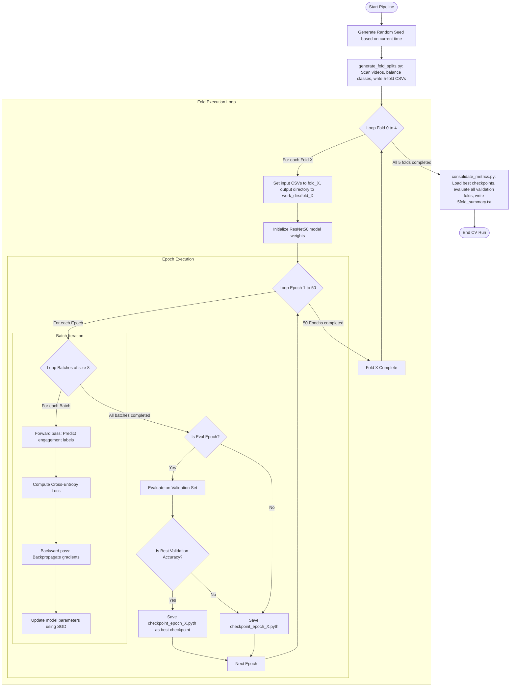

# 🎓 Understanding 5-Fold Cross-Validation: Folds, Epochs, and Iterations

This document explains in detail how the OUC-CGE classroom engagement model is trained, how the dataset is split, and how **Folds**, **Epochs**, **Iterations (Batches)**, and **Repeated Cross-Validation Iterations** interact.

---

## 1. The Core Terminology

Before looking at the training loop, let's define the fundamental concepts:

### A. The Fold
A **Fold** is a subset of your dataset. In **5-Fold Cross-Validation**, we split the total clean dataset into 5 equal, mutually exclusive parts (partitions).
*   **Stratification**: We ensure that each fold has the exact same proportion of class labels (Low, Medium, High) as the original dataset.
*   **Downsampling (Balancing)**: The majority classes are downsampled so that each class has the exact same number of samples. This ensures the model doesn't bias toward the most frequent class.

For OUC-CGE, our total balanced dataset contains **6,159 videos** (2,053 per class).
*   Each fold contains **1,231 or 1,232 videos** (approx. 411 per class).

---

### B. The Epoch
An **Epoch** represents **one complete pass of the training algorithm through the entire training dataset**. 
*   If we configure the training for `MAX_EPOCH: 50`, it means the model will look at the entire training dataset **50 separate times** during training.
*   With each epoch, the model updates its internal weights to minimize the loss and improve classification accuracy.

---

### C. The Iteration (or Step)
An **Iteration** is a single update of the model's weights. Because video datasets are large, we cannot feed the entire training set to the GPU at once. Instead, we split the training set into small groups called **Batches** (configured via `BATCH_SIZE`).
*   **1 Iteration** = Forward pass + Backward pass + Weight update on **one batch of videos**.
*   **Number of Iterations per Epoch** = `Total Training Samples` / `Batch Size`.

For example, in Fold 0 training:
*   Total Training Samples = **4,926 videos** (Folds 1, 2, 3, 4 combined).
*   `BATCH_SIZE` = **8 videos**.
*   **Iterations per Epoch** = 4,926 / 8 = **615 iterations**.
*   This means in a single epoch, the model updates its weights 615 times. For 50 epochs, the model will run $615 \times 50 = 30,750$ iterations.

---

### D. The CV Iteration (Repeated Run)
A **CV Iteration** (sometimes called a *Repeated Cross-Validation run*) represents executing the entire 5-fold cross-validation loop from scratch.
*   By default, if we use a fixed random seed (like `42`), we will get the exact same fold splits every time we run the script.
*   If we use a **dynamic random seed** (based on the current system time), each run of `generate_fold_splits.py` will generate **entirely different, randomized splits** of the dataset.
*   Running multiple iterations of 5-fold cross-validation ensures that the model's performance metrics (Accuracy, Macro-F1, QWK) are not anomalies of one specific split of the data, but are statistically robust.

---

## 2. How the 5-Fold Cross-Validation Works

In 5-Fold Cross-Validation, we train **5 separate models** (one for each fold). For each model, we reserve one fold as the validation set and train on the other four.

```mermaid
grid
  classDef train fill:#4b6cb7,stroke:#333,stroke-width:2px,color:#fff
  classDef val fill:#ff6b6b,stroke:#333,stroke-width:2px,color:#fff

  subgraph Fold 0 Run
    direction LR
    F0_1["Fold 0 (Val)"]:::val
    F0_2["Fold 1 (Train)"]:::train
    F0_3["Fold 2 (Train)"]:::train
    F0_4["Fold 3 (Train)"]:::train
    F0_5["Fold 4 (Train)"]:::train
  end

  subgraph Fold 1 Run
    direction LR
    F1_1["Fold 0 (Train)"]:::train
    F1_2["Fold 1 (Val)"]:::val
    F1_3["Fold 2 (Train)"]:::train
    F1_4["Fold 3 (Train)"]:::train
    F1_5["Fold 4 (Train)"]:::train
  end

  subgraph Fold 2 Run
    direction LR
    F2_1["Fold 0 (Train)"]:::train
    F2_2["Fold 1 (Train)"]:::train
    F2_3["Fold 2 (Val)"]:::val
    F2_4["Fold 3 (Train)"]:::train
    F2_5["Fold 4 (Train)"]:::train
  end

  subgraph Fold 3 Run
    direction LR
    F3_1["Fold 0 (Train)"]:::train
    F3_2["Fold 1 (Train)"]:::train
    F3_3["Fold 2 (Train)"]:::train
    F3_4["Fold 3 (Val)"]:::val
    F3_5["Fold 4 (Train)"]:::train
  end

  subgraph Fold 4 Run
    direction LR
    F4_1["Fold 0 (Train)"]:::train
    F4_2["Fold 1 (Train)"]:::train
    F4_3["Fold 2 (Train)"]:::train
    F4_4["Fold 3 (Train)"]:::train
    F4_5["Fold 4 (Val)"]:::val
  end
```

### The Fold Loop:
1.  **Fold 0**:
    *   **Training Set**: Folds 1 + 2 + 3 + 4 (~4,926 videos)
    *   **Validation Set**: Fold 0 (~1,233 videos)
    *   Train for **50 Epochs**. At the end of each epoch, evaluate on the validation set. Save the best model checkpoint.
2.  **Fold 1**:
    *   **Training Set**: Folds 0 + 2 + 3 + 4
    *   **Validation Set**: Fold 1
    *   Train for **50 Epochs**. Save the best checkpoint.
3.  **Fold 2** ... **Fold 4**: Repeat the same process.
4.  **Consolidation**:
    *   After all 5 folds complete, we load the best checkpoint of each fold, run validation inference, and compute final metrics (Accuracy, Macro-F1, QWK) for each fold.
    *   Average the metrics of all 5 folds to get the final overall score.

---

## 3. The Nested Training Loops: A Detailed Visual Guide

Here is a step-by-step breakdown of how the entire multi-iteration training pipeline runs in code:



---

## 4. Parameter Overview for Full Run

To execute the entire plan exactly as required:

| Parameter | Value | Description |
| :--- | :--- | :--- |
| **`NUM_FOLDS`** | `5` | Total folds for cross-validation |
| **`MAX_EPOCH`** | `50` | Total training epochs per fold |
| **`BATCH_SIZE`** | `8` | Number of video clips processed per GPU step (reduced from 16 to avoid Out-Of-Memory errors on 8GB VRAM) |
| **`NUM_WORKERS`** | `4` | CPU workers loading data in parallel (reduced from 8 to prevent multi-processing bottlenecks on Windows) |
| **`BASE_LR`** | `0.1` | Starting learning rate, using cosine annealing scheduler |
| **`MODEL.NUM_CLASSES`**| `3` | Engagement classification labels: Low (0), Medium (1), High (2) |

---

## 5. Running Multiple CV Iterations (Repeated CV)

If you wish to run the entire 5-fold cross-validation loop **multiple times (iterations)** to average out split randomness, you do the following:

### Run 1:
1.  Run `generate_fold_splits.py` (picks Random Seed A based on time).
2.  Run `run_5fold.py` (trains 5 folds for 50 epochs each).
3.  Run `consolidate_metrics.py` (saves report to `5fold_summary.txt`).
4.  Copy the summary: `cp work_dirs/5fold_summary.txt work_dirs/summary_run_1.txt`.

### Run 2:
1.  Run `generate_fold_splits.py` again (picks Random Seed B based on new time).
2.  Delete or move old checkpoints: `mv work_dirs work_dirs_run1` so training starts fresh.
3.  Run `run_5fold.py` (trains 5 new folds for 50 epochs each).
4.  Run `consolidate_metrics.py` (saves new report to `5fold_summary.txt`).
5.  Copy the summary: `cp work_dirs/5fold_summary.txt work_dirs/summary_run_2.txt`.

This ensures the model's accuracy is tested across different random combinations of students/classroom videos.
