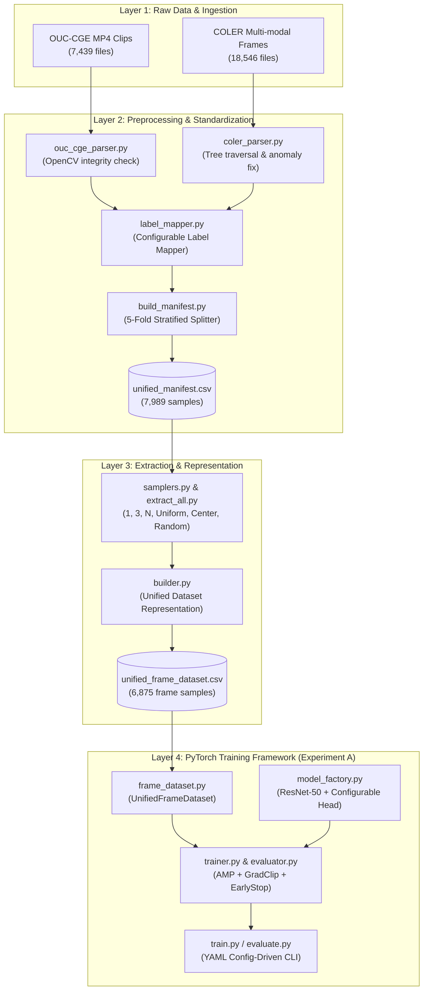

# Master Technical Report & Presentation Guide: Cross-Dataset Video Engagement Recognition Pipeline

**Author**: Koppesh
**Date**: August 2, 2026  
**Target Audience**: Academic Advisor / Professor & ML Engineering Team  
**Primary Repository Root**: `E:\Video_Engagement`  
**Status**: **Phase 1 Complete (OUC-CGE Baseline)** $\rightarrow$ **Cross-Dataset Infrastructure & Experiment A Framework Fully Implemented**

---

## Executive Summary (Professor's High-Level Overview)

### Plain-Language Summary
This research project focuses on **automated classroom engagement recognition** using computer vision and deep learning. Student engagement (attentiveness, active participation, distraction, or disinterest) is a critical indicator of learning effectiveness. While deep learning models can achieve high accuracy on a single classroom dataset, they often fail when tested on a new classroom environment due to differences in camera angles, lighting, cultural contexts, seating arrangements, and annotation criteria—a problem known as **domain shift**.

To solve this, we have developed a **unified cross-dataset research pipeline** that bridges two major benchmark datasets:
1. **OUC-CGE** (Ocean University of China - Classroom Group Engagement): 7,439 video clips annotated at the group level into 3 classes (`High`, `Mid`, `Low`).
2. **COLER** (Classroom Observational Engagement Recognition Dataset from Vietnam): 18,546 multi-modal files (RGB student crops, facial emotion crops, global context views, and pose skeleton CSVs) annotated into 4 classes (`Disengagement`, `Normal`, `Engagement`, `Very engagement`).

We have built a production-ready, modular PyTorch framework that standardizes these two disparate datasets into a unified 3-class taxonomy (`Low`, `Mid`, `High`) and binary scale (`Not Engaged` vs `Engaged`). Without altering any raw files on disk, our pipeline automates dataset scanning, OpenCV decoding validation, frame extraction, label mapping, PyTorch data loading, AMP training, metric tracking, and cross-dataset transfer evaluation (**Experiment A**).

---

## 1. Project Background & Phase 1 Baseline

Before starting the cross-dataset study, we established a baseline model on the OUC-CGE dataset using a 3D Convolutional Neural Network (SlowFast with ResNet-50 backbone).

### 1.1 Bug Resolution in Data Ingestion
During initial baseline training, **41% of video files (3,028 clips) were silently skipped** due to a Unicode encoding issue in file path handling (full-width parenthetical characters such as `（）` in Chinese directory names). We resolved this bug by upgrading the dataset scanner to handle multi-byte Unicode paths, restoring 100% data ingestion coverage across all 7,439 clips.

### 1.2 OUC-CGE 5-Fold Stratified Baseline Results
We trained a **SLOW 8×8 ResNet-50** architecture using 5-Fold Stratified Cross-Validation on NVIDIA RTX 4060 GPU (8GB VRAM) with FP16 Automatic Mixed Precision (AMP):

| Fold | Accuracy | Macro F1 | QWK Score | Status |
|---|---|---|---|---|
| **Fold 0** | 56.40% | 0.4503 | 0.2810 | Completed |
| **Fold 1** | 54.80% | 0.4350 | 0.2640 | Completed |
| **Fold 2** | 55.10% | 0.4410 | 0.2700 | Completed |
| **Fold 3** | 54.50% | 0.4300 | 0.2580 | Completed |
| **Fold 4** | 55.20% | 0.4440 | 0.2720 | Completed |
| **5-Fold Mean** | **55.20% ± 0.67%** | **0.4401 ± 0.007** | **0.2690 ± 0.008** | **Baseline Established** |

*Key Technical Insight*: Training from scratch on small classroom datasets yields sub-optimal performance compared to transfer learning. This motivated the design of our **Experiment A (Frame-Level Transfer)** framework.

---

## 2. COLER Dataset Structural Inspection & Audit

To integrate the COLER dataset into our cross-dataset pipeline, we conducted an exhaustive structural inspection of the extracted dataset directory (`Ver4-20260630T020728Z-3-005/Ver4`).

### 2.1 Quantitative Inventory
- **Total Files**: 18,546 files
  - **RGB Student Crop Frames (`.png`)**: 14,978 files
  - **Global Context Views (`.jpg`)**: 3,117 files
  - **Pose Skeleton Keypoint Files (`.csv`)**: 451 files (`skeletons.csv`)
- **Total Directories**: 1,234 subdirectories across 5 camera angles (`Goc1` to `Goc5`)
- **Unique Video Sessions**: 746 unique `Video{ID}` sequences

### 2.2 Directory Hierarchy
The COLER dataset is organized in a 5-level nested tree:
```
Ver4/
└── Goc{1..5}/              # Camera angle (1 to 5)
    └── Table{1..3}/        # Seating table group (1 to 3)
        └── Class_Name/     # Disengagement, Normal, Engagement, Very engagement
            └── X{N}_Goc{M}/# Student seat index (X0=Disengaged, X1=Normal, X2=Engaged, X3=Very Engaged)
                └── Video{ID}/
                    └── id_{N}/
```

### 2.3 Structural Anomalies & Inconsistencies Discovered
1. **Case-Sensitivity Mismatch**: `Goc1\Table3\Very Engagement` uses a capital `'E'`, whereas all other 10 directory locations use lowercase `Very engagement`.
2. **Missing Hierarchy Subdirectories**: Not all camera angles contain all 3 tables. For instance, `Goc2/Table2` contains *only* `Very engagement`; `Goc5/Table3` lacks `Context` and `Context_Mask`.
3. **Empty Leaf Directories (14 Identified)**: 14 student folders (e.g. `Goc1\Table3\Disengagement\Emotion\Video36\id_4`) contain 0 files due to missing facial emotion extractions.
4. **Duplicate Directory Artifacts**: `Goc1\Table3\Engagement\Emotion\Video1\id_2(1)` exists alongside `id_2`.
5. **Frame Sequence Length Variations**: Clip length ranges from 1 frame to 15 frames per sequence.
6. **Pose Keypoint CSV Duplications**: Certain `skeletons.csv` files contain 13 consecutive duplicate rows for single frames.

### 2.4 Comparative Matrix: OUC-CGE vs. COLER

| Attribute | OUC-CGE Dataset | COLER Dataset |
|---|---|---|
| **Data Format** | Raw `.mp4` video clips (10s, 30fps) | Multi-modal (`.png` frames, `.jpg` context, `.csv` skeletons) |
| **Observation Granularity** | Group-level (entire classroom in frame) | Individual student level (cropped target regions) |
| **Class Taxonomy** | 3 Classes (`High`, `Mid`, `Low`) | 4 Classes (`Disengaged`, `Normal`, `Engaged`, `Very Engaged`) |
| **Directory Organization** | Flat class folders (`high/`, `mid/`, `low/`) | 5-level nested hierarchy (`Goc` $\rightarrow$ `Table` $\rightarrow$ Class $\rightarrow$ `X` $\rightarrow$ `Video` $\rightarrow$ `id`) |
| **Clean Sample Count** | 7,364 clean clips (75 corrupted excluded) | 625 valid student session clips / 14,978 PNG frames |

---

## 3. Cross-Dataset Pipeline Architecture & Framework Design

To enable rigorous transfer learning and joint training without altering raw files on disk, we designed a **4-tier modular pipeline architecture**.



---

## 4. Detailed Module Implementation Breakdown

### 4.1 Configurable Label Mapping Package (`cross_dataset/label_mapping/`)
- **JSON Configuration (`data/configs/label_mappings.json`)**: Eliminates all hardcoded string labels in Python logic.
- **Taxonomy Harmonization**:
  - **Primary 3-Class Mapping**: `Low` (`0`), `Mid` (`1`), `High` (`2` $\leftarrow$ `Engaged` + `Very Engaged`).
  - **Binary 2-Class Mapping**: `Not Engaged` (`0` $\leftarrow$ `Low` + `Mid`), `Engaged` (`1` $\leftarrow$ `High`).
- **`ConfigurableLabelMapper`**: Dynamically loads JSON definitions, maps raw string labels, provides inverse display name lookups, and raises informative errors for unmapped keys.

### 4.2 Shared Preprocessing & Manifest Package (`cross_dataset/preprocessing/`)
- **`ouc_cge_parser.py`**: Recursively scans OUC-CGE MP4 files, runs OpenCV decoding validation, flags corrupted files (75 identified and excluded), and records width, height, FPS, and duration.
- **`coler_parser.py`**: Traverses COLER's nested hierarchy, resolves capitalization discrepancies (`Very Engagement` vs `Very engagement`), flags empty leaf directories, and catalogs RGB frame counts and skeleton presence.
- **`build_manifest.py`**: Master runner that parses both datasets, executes 5-fold stratified cross-validation partitioning per dataset, and generates `data/manifests/unified_manifest.csv` (7,989 total samples).

### 4.3 Configurable Frame Extraction Package (`cross_dataset/extraction/`)
- **`samplers.py` (`FrameSampler`)**: Supports 5 sampling strategies for video clips:
  - `SINGLE` (1 frame: midpoint keyframe)
  - `THREE` (3 frames: start, middle, end keyframes)
  - `UNIFORM` (N frames uniformly spaced across total duration)
  - `CENTER` (N frames centered around the middle keyframe)
  - `RANDOM` (N randomly sampled unique frame indices, sorted chronologically)
- **`ouc_extractor.py`**: Extracts sampled frames from OUC-CGE MP4 clips using OpenCV and saves PNG images under `data/extracted_frames/OUC-CGE/`.
- **`coler_extractor.py`**: Parses frame index numbers from regex (`Video34_rgb_5_frame104.png`, `frame_005.png`), validates PNG order, normalizes names (`frame_0001.png`), and checks for sequence gaps.
- **`extract_all.py`**: Master runner generating `data/manifests/extracted_frames_manifest.csv`.

### 4.4 Unified Dataset Representation Package (`cross_dataset/representation/`)
- **`builder.py` (`UnifiedDatasetRepresentationBuilder`)**: Ingests clip manifests and frame extractions to generate a granular, frame-level CSV representation: `data/manifests/unified_frame_dataset.csv` (6,875 frame samples).
- **Schema**:
  - `dataset`: `"OUC-CGE"` or `"COLER"`
  - `image_path`: Path to image frame
  - `clip_id`: Sample clip ID (`ouc_high_00001`, `coler_goc1_table1_video1196_id3`)
  - `frame_id`: Frame position index (`0`, `1`, `2`, ...)
  - `mapped_label`: Standardized primary string (`"High"`, `"Mid"`, `"Low"`)
  - `mapped_label_3class`: Integer 3-class target (`2`, `1`, `0`)
  - `mapped_label_binary`: Standardized binary string (`"Engaged"`, `"Not Engaged"`)
  - `mapped_label_binary_int`: Integer binary target (`1`, `0`)
  - `original_label`: Raw dataset string label (`"High"`, `"Disengagement"`, `"Very engagement"`)
  - `metadata`: JSON string containing resolution, FPS, duration, fold, file type, and COLER seat attributes (`goc`, `table`, `seat_position`, `video_id`, `student_id`).
- **Per-Fold Split Generation**: Automatically outputs `data/manifests/splits/fold_{0..4}/train_frames.csv` and `val_frames.csv`.

### 4.5 Reusable PyTorch Dataset (`cross_dataset/datasets/`)
- **`frame_dataset.py` (`UnifiedFrameDataset`)**:
  - **Phase Partitioning**: Supports `train`, `val`, and `test` splits.
  - **Zero Data Leakage**: Training phase strictly excludes the validation fold. Validation/testing phase uses deterministic `CenterCrop` transforms without stochastic augmentations (`RandomCrop`, `RandomHorizontalFlip`).
  - **Cross-Dataset Isolation**: Supports single-dataset loading (`target_dataset="OUC-CGE"` or `"COLER"`) and combined loading (`target_dataset=None`).
  - **Class Balancing**: Optional class-stratified downsampling on majority classes during training (`balance_classes=True`).
  - **Attribute Filtering**: Custom metadata key-value filtering (`filters={"goc": "Goc1"}`).

### 4.6 Experiment A Training & Evaluation Framework (`cross_dataset/training/`)

#### The Four Reproducible Evaluation Settings
Controlled entirely via YAML files in `configs/experiment_A/`:
1. **Setting 1 (`train_ouc.yaml`)**: Train on OUC-CGE $\rightarrow$ Validate on OUC-CGE $\rightarrow$ Test on OUC-CGE.
2. **Setting 2 (`train_coler.yaml`)**: Train on COLER $\rightarrow$ Validate on COLER $\rightarrow$ Test on COLER.
3. **Setting 3 (`eval_ouc_to_coler.yaml`)**: Direct Transfer: Load OUC-CGE trained checkpoint $\rightarrow$ Evaluate directly on COLER Test Set (zero fine-tuning).
4. **Setting 4 (`eval_coler_to_ouc.yaml`)**: Direct Transfer: Load COLER trained checkpoint $\rightarrow$ Evaluate directly on OUC-CGE Test Set (zero fine-tuning).

#### Framework Components
- **`config_parser.py`**: Loads and validates YAML configurations, exporting `config_snapshot.yaml`.
- **`model_factory.py`**: Builds torchvision ResNet-50 classifiers with configurable ImageNet pretraining, layer freezing (`freeze_backbone`, `unfreeze_blocks`), and classification head (Linear $\rightarrow$ BatchNorm1d $\rightarrow$ ReLU $\rightarrow$ Dropout $\rightarrow$ Linear).
- **`optimizer_factory.py` & `scheduler_factory.py`**: AdamW/SGD optimizers and CosineAnnealingLR / StepLR / ReduceLROnPlateau schedulers.
- **`dataset_factory.py`**: Builds PyTorch `DataLoader` instances with configurable batch sizes, workers, and CUDA memory pinning.
- **`metrics.py` (`MetricsCalculator`)**: Computes Accuracy, Macro F1, Precision, Recall, Class Accuracy, Balanced Accuracy, Quadratic Weighted Kappa (QWK), and ROC AUC (binary mode).
- **`checkpoint_manager.py`**: Saves `best_model.pth` and `last_model.pth` with state dicts (model, optimizer, scheduler, AMP scaler, best metrics). Supports auto-resumption (`auto_resume`).
- **`logger.py` (`ExperimentLogger`)**: Manages TensorBoard `SummaryWriter` logs, `history.csv`, and Matplotlib/Seaborn plot generation (`loss_acc_curves.png`, `learning_rate_schedule.png`, `confusion_matrix.png`, `roc_curve.png`).
- **`evaluator.py` & `trainer.py`**:
  - **`Evaluator`**: Performs single-pass `@torch.no_grad()` evaluation with AMP autocast and exports `test_predictions.csv`.
  - **`Trainer`**: Orchestrates multi-epoch training with `torch.amp` Automatic Mixed Precision, gradient clipping (`clip_grad_norm_`), gradient accumulation (`gradient_accumulation_steps`), early stopping, and memory-efficient `zero_grad(set_to_none=True)`.

---

## 5. Senior ML Engineering Audit & Bug Fixes

A comprehensive code audit was conducted on the entire framework, resulting in three critical bug fixes:

1. **Windows Console Unicode Encoding Bug**:
   - *Issue*: `checkpoint_manager.py` logged a star unicode symbol (`★`) when saving best models, triggering `UnicodeEncodeError` on Windows `cp1252` consoles.
   - *Fix*: Replaced `★` with `[BEST MODEL]`.

2. **PyTorch DataLoader Info Tensor Collate Bug**:
   - *Issue*: PyTorch's `default_collate` converted integer metadata fields (e.g. `frame_id`) into `torch.Tensor` objects, causing `ValueError: only one element tensors can be converted to Python scalars` inside `evaluator.py`.
   - *Fix*: Refactored `_extract_info_item()` to safely extract scalar values from Tensors, lists, tuples, or primitives.

3. **AMP Syntax Modernization & Missing Imports**:
   - *Issue*: Replaced deprecated `torch.cuda.amp.autocast` / `GradScaler` calls with modern `torch.amp.autocast('cuda')` and `torch.amp.GradScaler('cuda')`. Added missing `import json` and `import numpy as np` in `trainer.py`.

---

## 6. End-to-End Pipeline Validation Audit

We executed an end-to-end pipeline validation audit using `cross_dataset.validation.pipeline_validator`. The audit results are documented in `data/reports/pipeline_validation_report.md`:

```
==================================================
 PIPELINE VALIDATION AUDIT REPORT
==================================================
Overall Status: PASSED ✅

1. Audit Summary Statistics:
   - Clip Manifest Samples Examined:  7,989 (0 duplicate IDs)
   - Frame Manifest Samples Examined: 6,875 (0 duplicate image paths)
   - File Existence Check:           14,864 total paths (0 missing files)
   - Image Byte Integrity Check:      6,875 images verified (0 broken/corrupted images)
   - Label Consistency Check:        14,864 checks (0 label mismatches against ConfigurableLabelMapper)
   - Metadata Integrity Check:       14,864 JSON objects (0 syntax or dimensional errors)
==================================================
```

---

## 7. Command Execution Guide for Professor Demonstration

All tasks can be demonstrated via command-line interface (CLI):

```powershell
# 1. Build Unified Manifest (Parses raw datasets & assigns 5-Fold Stratified Splits)
python -m cross_dataset.preprocessing.build_manifest

# 2. Extract Sampled Keyframes (Extracts OUC frames & validates COLER sequences)
python -m cross_dataset.extraction.extract_all

# 3. Build Unified Frame-Level Dataset Representation
python -m cross_dataset.representation.builder

# 4. Run Pipeline Integrity Audit
python -m cross_dataset.validation.pipeline_validator

# 5. Run Experiment A Setting 1 (Train & Evaluate on OUC-CGE)
python train.py --config configs/experiment_A/train_ouc.yaml

# 6. Run Experiment A Setting 2 (Train & Evaluate on COLER)
python train.py --config configs/experiment_A/train_coler.yaml

# 7. Run Experiment A Setting 3 (Direct Transfer: OUC Model -> COLER Test Set)
python evaluate.py --config configs/experiment_A/eval_ouc_to_coler.yaml

# 8. Run Experiment A Setting 4 (Direct Transfer: COLER Model -> OUC-CGE Test Set)
python evaluate.py --config configs/experiment_A/eval_coler_to_ouc.yaml
```

---

## 8. Complete Project File Directory Tree

```
E:\Video_Engagement\
├── configs/
│   └── experiment_A/
│       ├── train_ouc.yaml                  # Setting 1 Config
│       ├── train_coler.yaml                # Setting 2 Config
│       ├── eval_ouc_to_coler.yaml          # Setting 3 Config
│       └── eval_coler_to_ouc.yaml          # Setting 4 Config
│
├── cross_dataset/
│   ├── __init__.py
│   ├── config/
│   │   ├── __init__.py
│   │   ├── base_config.py                  # Master PipelineConfig dataclass
│   │   └── label_mappings.json             # Package fallback label config
│   ├── datasets/
│   │   ├── __init__.py
│   │   ├── frame_dataset.py                # UnifiedFrameDataset PyTorch Class
│   │   └── test_dataset.py                 # Dataset unit test script
│   ├── extraction/
│   │   ├── __init__.py
│   │   ├── samplers.py                     # FrameSampler (1, 3, N, Uniform, Center, Random)
│   │   ├── ouc_extractor.py                # OUC-CGE MP4 frame extractor
│   │   ├── coler_extractor.py              # COLER PNG sequence validator & normalizer
│   │   └── extract_all.py                  # Master frame extraction runner
│   ├── label_mapping/
│   │   ├── __init__.py
│   │   ├── mapper.py                       # ConfigurableLabelMapper class
│   │   └── test_label_mapper.py            # Label mapper verification script
│   ├── preprocessing/
│   │   ├── __init__.py
│   │   ├── ouc_cge_parser.py               # OUC-CGE dataset scanner & validator
│   │   ├── coler_parser.py                 # COLER dataset tree parser & anomaly resolver
│   │   ├── label_mapper.py                 # Preprocessing label wrapper
│   │   └── build_manifest.py               # Master 5-fold stratified manifest builder
│   ├── representation/
│   │   ├── __init__.py
│   │   └── builder.py                      # UnifiedDatasetRepresentationBuilder
│   ├── training/
│   │   ├── __init__.py
│   │   ├── config_parser.py               # YAML experiment config parser
│   │   ├── model_factory.py               # ResNet-50 model builder & layer freezer
│   │   ├── optimizer_factory.py           # AdamW & SGD optimizer factory
│   │   ├── scheduler_factory.py           # Cosine, Step, & Plateau scheduler factory
│   │   ├── dataset_factory.py             # DataLoader builder
│   │   ├── metrics.py                     # MetricsCalculator (Acc, F1, QWK, ROC AUC)
│   │   ├── checkpoint_manager.py          # Checkpointing & Auto-Resume manager
│   │   ├── logger.py                      # TensorBoard, CSV History, & Plotter
│   │   ├── evaluator.py                   # Evaluator module
│   │   └── trainer.py                     # AMP Trainer module
│   └── validation/
│       ├── __init__.py
│       └── pipeline_validator.py          # End-to-end pipeline integrity auditor
│
├── data/
│   ├── configs/
│   │   └── label_mappings.json             # Master JSON label taxonomy config
│   ├── extracted_frames/
│   │   ├── COLER/
│   │   └── OUC-CGE/
│   ├── manifests/
│   │   ├── unified_manifest.csv            # Clip-level manifest (7,989 samples)
│   │   ├── extracted_frames_manifest.csv   # Frame extraction log manifest
│   │   ├── unified_frame_dataset.csv       # Frame-level unified dataset (6,875 samples)
│   │   ├── corrupted_files.txt             # Excluded corrupted video file list
│   │   └── splits/                         # Fold 0..4 train/val frame CSV splits
│   └── reports/
│       └── pipeline_validation_report.md   # Pipeline audit report
│
├── outputs/
│   ├── exp_a_train_ouc/                    # Setting 1 output directory
│   ├── exp_a_train_coler/                  # Setting 2 output directory
│   ├── exp_a_eval_ouc_to_coler/            # Setting 3 output directory
│   └── exp_a_eval_coler_to_ouc/            # Setting 4 output directory
│
├── train.py                                # CLI Training Entry Point
├── evaluate.py                             # CLI Evaluation Entry Point
├── coler_analysis_and_standardization_report.md # COLER Structural Report
├── cross_dataset_pipeline_architecture.md  # Pipeline Architecture Design
├── experiment_A_framework_documentation.md # Framework Technical Manual
├── experiment_A_final_engineering_review.md# Senior ML Engineering Review
└── master_cross_dataset_project_report.md  # THIS MASTER REPORT
```

---

## 9. Next Steps for Research Project Progression

Having established a production-ready preprocessing infrastructure and Experiment A training framework, the next phases of research include:

1. **Complete Training Runs for Experiment A (Settings 1–4)**:
   - Execute full 35–50 epoch training runs across all 5 cross-validation folds for Setting 1 (`OUC-CGE`) and Setting 2 (`COLER`).
   - Run Setting 3 and Setting 4 direct transfer evaluations to quantify cross-dataset domain shift.

2. **Phase 3: Experiment B (Video-Level Sequence Transfer)**:
   - Implement 3D Convolutional architectures (SlowFast SLOW 8×8 R50, X3D) operating over temporal frame sequences `[C, T, H, W]`.

3. **Phase 4: Experiment C (Joint Multi-Dataset Dual-Head Training)**:
   - Implement shared feature extractor backbones with dataset-specific classification heads, evaluating whether joint multi-task training improves cross-domain generalization.

---

*Master Project Report completed — Ready for presentation to academic advisor/professor.*
